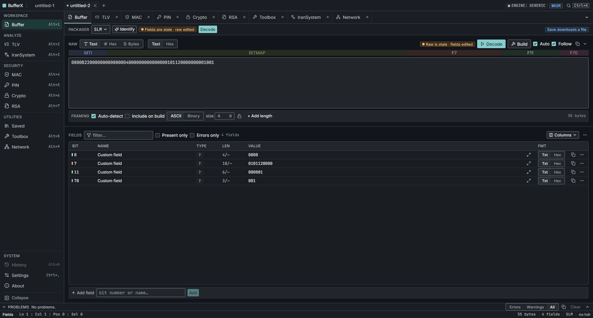
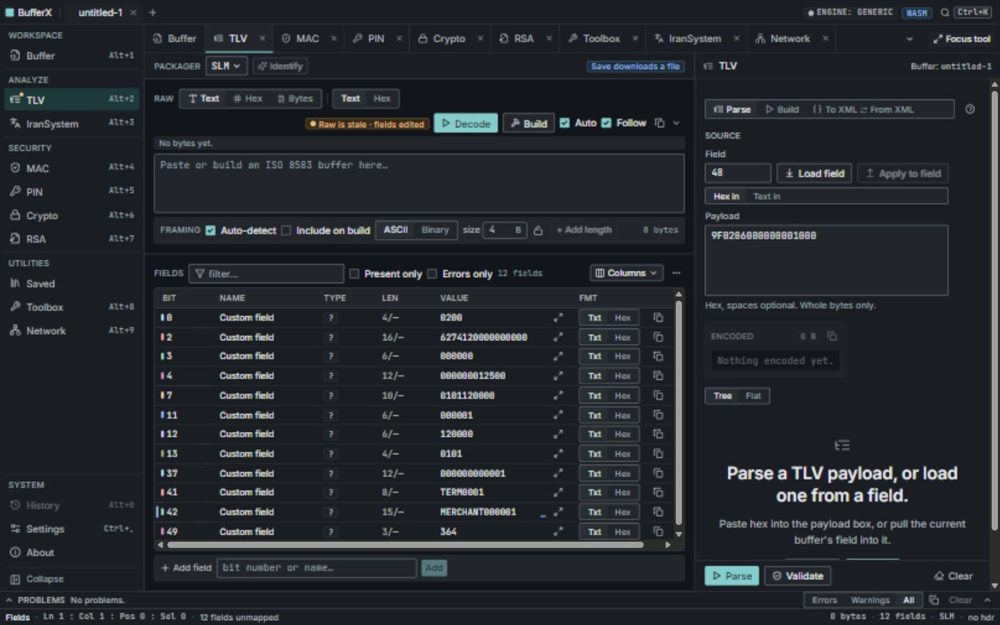

# BufferX

BufferX is a workbench for ISO 8583 buffers and the banking-adjacent operator tasks that surround
them — MAC calculation, PIN blocks, key crypto, RSA, TLV, and IranSystem text conversion.

It is built around one workflow: **paste a raw buffer, see it decoded, change something, build it
back.** Tools open in their own workspace tabs, and you can put one beside the buffer when you need
to compare both at once.

## Screenshots

The workspace strip keeps every open tool one click away without squeezing them into a narrow stack.
Choose **Split with buffer** to work on a tool and the message side by side. On smaller windows, the
selected workspace gets the full area.



*An 0800 network management message with its MTI, bitmap, transmission time, trace number and network code visible in the buffer workspace.*



*Split view keeps the message and its tool visible together.*

> **Version 2.0 replaced the entire user interface.** The Qt/QML desktop app is gone, rewritten as a
> React frontend in a Tauri shell. The tested C++ banking core was kept and made dependency-free, so
> the same engine now also compiles to WebAssembly and BufferX can run in a browser.

## What it does

**Buffer workspace**
- Paste a buffer as text or hex; decode it against any of 32 packager definitions
- Build or clone packagers in the UI, edit field definitions, and import/export XML
- Field table with inline editing, per-field hex view, filtering, and add/remove field
- Hex view with per-field colour coding — hover a field to see its bytes, hover bytes to find the field
- ASCII and binary length headers, with auto-detection
- Rebuild the buffer from edited fields; staleness is tracked so you always know whether what you are
  looking at matches what you last built
- Save and load buffers as `.bxb` documents (JSON underneath), plus a **saved-buffers library**: a
  folder of reusable test messages you curate, with only the folder path and your labels kept by the
  app — the messages themselves stay in your own files *(desktop only)*

**Security tools**
- MAC calculate and verify (ANSI X9.19, ISO 9797-1 method 1 and 2 padding)
- PIN blocks: ISO-0/1/3 create and decode, ISO-4 AES, 3DES block encrypt/decrypt, field 52 helpers,
  Visa PVV, IBM 3624 offset and verify, and ATM PIN block translation across formats and key types
- Symmetric crypto: DES and 3DES (ECB/CBC), AES-128 and AES-256 (ECB/CBC)
- RSA: sign and verify with SHA-1/256/512, encrypt and decrypt with OAEP or PKCS#1 v1.5

**Analysis and utilities**
- TLV parse (tree and flat views), build primitive and constructed nodes, validate, XML round trip
- Visual TLV byte inspector and LTV with configurable tag/length widths, byte order, and length scope
- JSON inspector with exact error locations, searchable tree, source navigation, and lossless formatting
- IranSystem conversion in both the normalized and ATM-engine (AlmasPlus-compatible) profiles
- Toolbox: BCD, XOR, Base64, MD5/SHA hashes, Luhn, DES parity, random keys, KCV, EBCDIC
- ISO host tester over raw TCP with none/ASCII/binary framing *(desktop only)*

Split-with-buffer choices and dock width survive reopening. The saved-buffer library defaults to
`saved-buffers` beside the desktop executable; Settings → Buffers offers a folder override.

**A `Legacy ATM Engine` mode** (off by default) switches the codec to engine-compatible BCD, binary
bitmaps, variable-length prefixes, framing, and partial-MAC field scope for legacy hosts.

## Architecture

```
app/         React + TypeScript frontend        →  runs in Tauri or in a browser
src-tauri/   Rust desktop shell                 →  FFI to the C ABI + TCP, file dialogs
core/        C++17 banking core + C ABI         →  native and wasm32-emscripten
data/        packager definitions (XML)
assets/      source artwork for the app icons
docs/        architecture, engine contract, UX spec, design system
scripts/     build and code-generation helpers

build/       every generated artifact, and nothing else  (git-ignored)
  ├─ cmake/    CMake configure + C++ test binaries
  ├─ rust/     Cargo target directory, including the shipped executable
  └─ web/      Vite bundle, embedded into the desktop binary at build time
```

Three toolchains write here, so their output is pointed at one place rather than left in three:
`src-tauri/.cargo/config.toml` sets Cargo's `target-dir`, `app/vite.config.ts` sets `outDir`, and
CMake is configured with `-B build/cmake`. Deleting `build/` is always a safe clean.

One JSON envelope (`bufferx_invoke`) connects the frontend to the core, served by either transport.
The frontend does not know which one it has; capabilities are negotiated at startup and anything the
current host cannot do is disabled with an explanation rather than hidden.

See [docs/ARCHITECTURE.md](docs/ARCHITECTURE.md), [docs/ENGINE_CONTRACT.md](docs/ENGINE_CONTRACT.md),
[docs/UX_SPEC.md](docs/UX_SPEC.md), and [docs/DESIGN_SYSTEM.md](docs/DESIGN_SYSTEM.md).

For the packager builder, TLV/LTV options, JSON inspection, network behavior, and library location,
see the [tools guide](docs/TOOLS_GUIDE.md).

## Build

### Requirements

- CMake 3.23+ and a C++17 compiler (MSVC 2022, clang, or gcc)
- OpenSSL (libcrypto). On Windows: `vcpkg install openssl:x64-windows`
- Node 20+ and pnpm
- Rust 1.77+ (desktop app only)

### Desktop

```bash
pnpm install
pnpm dev
```

`pnpm install` bootstraps both halves of the project — the root package (just the Tauri CLI) and
`app/` (the frontend) — via a `postinstall` hook. They are two independent pnpm projects, not a
workspace, because `app/` also ships standalone as the web build.

To produce a binary:

```bash
pnpm build:exe
```

The C++ core is built through CMake automatically as part of the Rust build. On Windows set
`VCPKG_ROOT` if vcpkg is not at `C:/vcpkg`.

> Use the Tauri CLI (`pnpm build:exe`), not `cargo build --release`. Plain cargo produces a binary
> that still points at the dev server instead of embedding the web bundle, so it opens to
> `ERR_CONNECTION_REFUSED` unless a Vite server happens to be running. Only the CLI sets up the
> production context.
>
> Close the app before rebuilding: a running instance holds the executable open and the build fails
> with a bare `Access is denied (os error 5)` that never names the cause.

`pnpm build` additionally produces installers (MSI and NSIS on Windows, deb/AppImage on Linux,
dmg on macOS).

### Web

The browser build needs the core compiled to WebAssembly, which requires the Emscripten SDK and a
WebAssembly build of OpenSSL. Each is a one-time setup:

```bash
scripts/setup-emsdk.ps1              # once, ~1.5 GB   (setup-emsdk.sh on Linux/macOS)
source third_party/emsdk/emsdk_env.sh
bash scripts/build-openssl-wasm.sh   # once, builds libcrypto.a for wasm32
bash scripts/build-wasm.sh           # produces app/public/wasm/bufferx_core.{js,wasm}
pnpm web:dev
```

Without `app/public/wasm/`, the frontend still builds and runs, but every engine call fails — there is
no engine to answer it. The desktop build has no such prerequisite; it links the C++ core natively
through Rust instead. Re-run `bash scripts/build-wasm.sh` whenever `core/` changes — the artifact is
git-ignored on purpose, so it has to be rebuilt locally or in CI rather than pulled from the repo.

`pnpm web:build` produces a static bundle at `build/web/`, deployable as-is. `pnpm web:build:hosted`
builds the same bundle under a `/bufferx/` base path with source maps disabled, for deployment behind
a reverse proxy at a subpath rather than at the origin root.

### Tests

```bash
cmake -S . -B build/cmake -DCMAKE_TOOLCHAIN_FILE=C:/vcpkg/scripts/buildsystems/vcpkg.cmake
cmake --build build/cmake
ctest --test-dir build/cmake --output-on-failure
pnpm typecheck
pnpm test
```

Or run everything in one pass with `powershell scripts/verify.ps1` (Windows) — it configures, builds,
and tests all of C++, the ABI, and the frontend, and exits non-zero on the first failure.

The C++ suite includes two differential tests that verify the portable Windows-1256 and EBCDIC codecs
are byte-for-byte identical to the Win32 APIs they replaced.

## Limits

- BufferX is test tooling, not an HSM. Clear PINs and keys pass through process memory by design.
- Nothing secret is ever persisted, logged, or placed in a URL — but the machine running it is still
  the trust boundary.
- RSA keys are supplied as PEM text (with a file picker on desktop).
- Nested TLV editing is XML-based rather than drag-and-drop.

## Licence and credits

Proprietary — see [LICENSE](LICENSE).

Created by Amirsalar Saberi rad — <https://amirsrad.ir>
