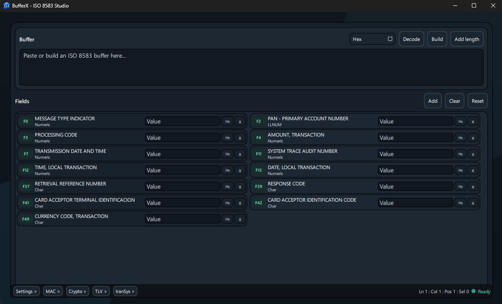

# BufferX

BufferX is a Qt 6 desktop workbench for ISO 8583 buffers and nearby operator tasks.

It is built around the practical workflow of:

- pasting a raw buffer and decoding it into fields
- editing fields and rebuilding the buffer
- switching between text and hex handling
- applying or removing message length headers
- calculating and verifying MAC values
- running standalone crypto transforms
- parsing TLV payloads
- working with IranSystem text conversion

## Screenshot



## Current Feature Set

- Qt/QML desktop UI
- XML-driven packager definitions from `data/packagers.xml`
- ISO 8583 encode/decode support for:
  - `MTI + bitmap + fields`
  - `bitmap first, no MTI`
  - `sequential fields, no bitmap`
- buffer input in text or hex
- field-level editing with per-field hex helpers
- optional ASCII and binary length headers
- buffer save/load as JSON
- MAC panel for calculate and verify flows
- crypto panel for:
  - `DES-ECB`
  - `DES-CBC`
  - `3DES-ECB`
  - `3DES-CBC`
  - `AES-128-ECB`
  - `AES-128-CBC`
  - `AES-256-ECB`
  - `AES-256-CBC`
- TLV parsing panel
- IranSystem conversion panel with UTF-8 / ANSI handling
- automated backend and integration-style tests

## Build

Requirements:

- CMake 3.23+
- Visual Studio 2022 toolchain on Windows
- Qt 6 with:
  - `Core`
  - `Gui`
  - `Qml`
  - `Quick`
  - `QuickControls2`
  - `Widgets`
- OpenSSL

### Debug

```powershell
cmake -S . -B cmake-build-debug
cmake --build cmake-build-debug --target BufferX --config Debug
```

Debug executable:

`cmake-build-debug/BufferX.exe`

### Release

```powershell
cmake -S . -B cmake-build-release
cmake --build cmake-build-release --target BufferX --config Release
```

Release executable:

`cmake-build-release/BufferX.exe`

## Tests

Build and run:

```powershell
cmake --build cmake-build-release --target BufferXTests --config Release
ctest --test-dir cmake-build-release --output-on-failure -C Release
```

Coverage currently includes:

- hex parsing and formatting
- XML loader behavior and failure cases
- ISO 8583 encode/decode paths
- packager layout handling
- MAC calculation and verification paths
- crypto backend paths
- TLV parsing
- IranSystem conversion paths
- save/load buffer persistence

## Packager XML

Packager definitions live in:

`data/packagers.xml`

The loader reads metadata such as:

- `Name`
- `MacMethod`
- `MacSize`
- `BitmapIndex`
- `SecondPartBitmap`
- `FieldCount`
- `LenFormat`
- `LenLen`

Field definitions include:

- `FieldId`
- `FieldType`
- `FieldLength`
- `FieldDesc`
- `Flags`

## Project Layout

- `main.cpp`
  - Qt application entry point
- `ui/Main.qml`
  - main desktop interface
- `src/Backend.*`
  - QML-facing bridge and JSON API
- `src/Iso8583.*`
  - core encode/decode logic
- `src/Packager*`
  - packager types and XML loader
- `src/Mac.*`
  - MAC engine
- `src/Crypto.*`
  - standalone cipher transforms
- `src/Tlv.*`
  - TLV parsing helpers
- `src/IranSystem.*`
  - IranSystem conversion support
- `src/Hex.*`
  - hex utilities
- `tests/BufferXTests.cpp`
  - test harness
- `ss/`
  - README screenshots

## Known Limits

- some binary and BCD semantics are still simplified for workstation use
- not every historical ISO 8583 dialect is modeled
- MAC behavior is practical and useful, but not every network-specific rule is implemented
- crypto tooling is an operator utility, not a full HSM or key-management stack
- there is no installer/package flow yet

## Status

BufferX is no longer just a parser prototype. It is now a multi-tool desktop utility for ISO 8583 decoding/building, MAC work, crypto transforms, TLV inspection, and IranSystem conversion.
